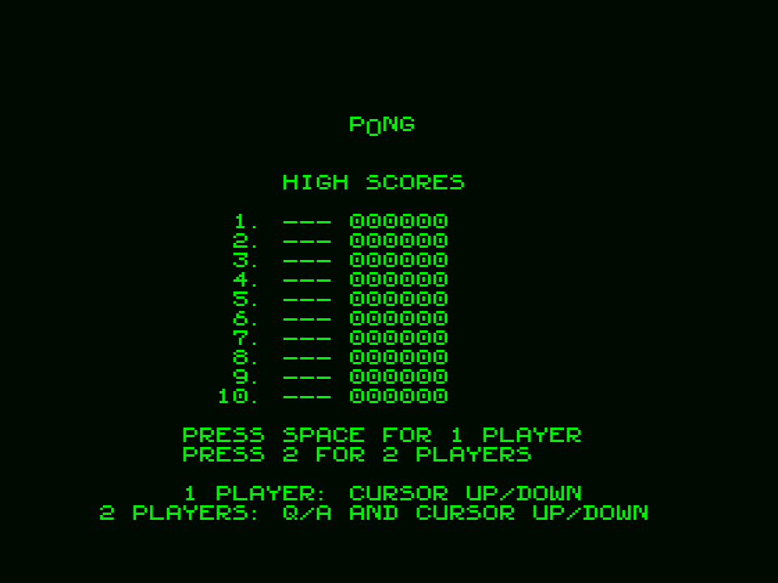
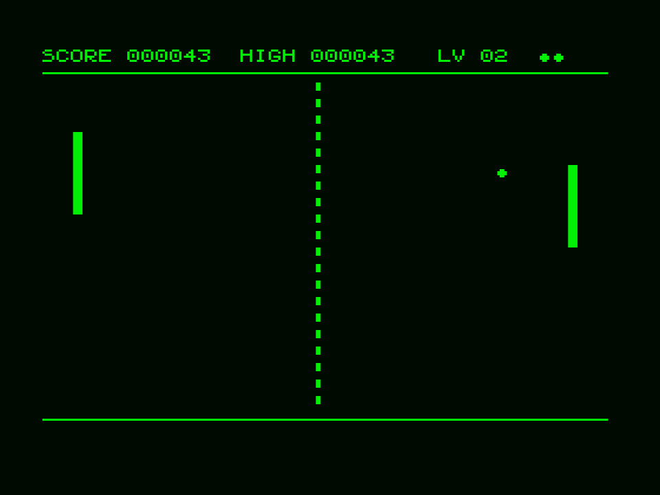
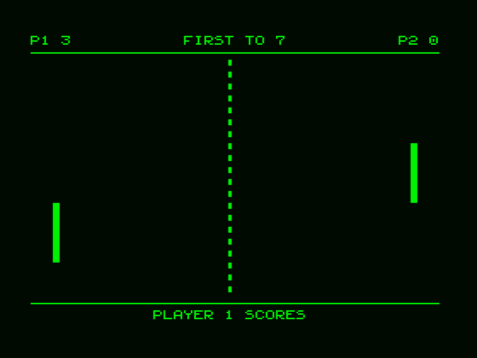
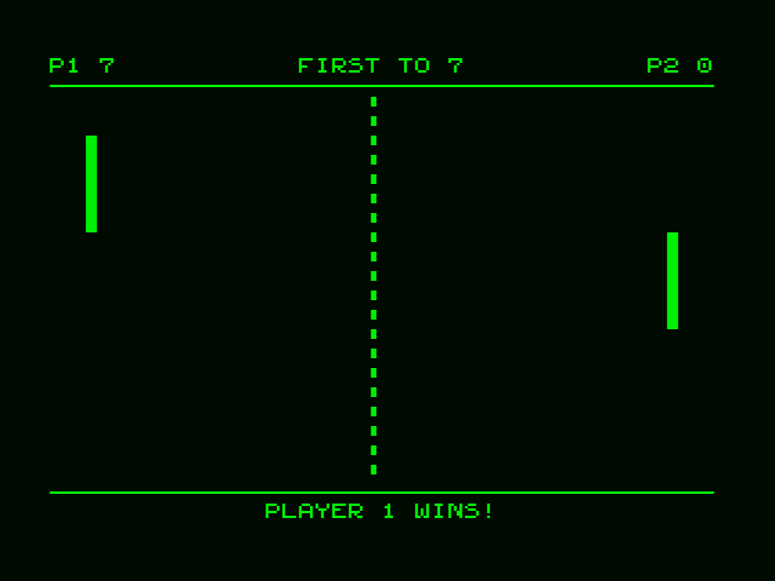

# P0NG

A Pong game for unexpanded MSX1, running entirely in SCREEN 0
(WIDTH 40) — no sprites, no per-cell color, just redefined text
characters. Plain 16KB ROM cartridge, no mapper. Same look and feel as
[c0man](https://github.com/TFHFony/c0man): green on black, `COLOR 2,1,1`.

▶ **[Play it online](https://www.file-hunter.com/Homebrew/?id=p0ng)**

## Screenshots

| Title screen | 1 player | 2 players | 2-player win |
|---|---|---|---|
|  |  |  |  |

## Playing

Load `p0ng.rom` in any MSX1 (or better) emulator, or put it on a cartridge.
On the title screen:

* **SPACE** (or **1**) — 1 player against the computer
* **2** — 2 players

### 1 player

* Cursor **UP/DOWN** moves your paddle (left side).
* Returning the ball is 1 point, the computer missing is 10 points.
* You have 3 lives; missing the ball costs one.
* Every 3 points won starts the next level and the ball gets faster.
* Where the ball hits your paddle decides its angle: the edges send it
  off steeply, the middle keeps its current angle. The computer paddle is
  always slower than the ball, so a steep shot can beat it.
* A 10-entry high score list keeps 3-letter names.

### 2 players

* Left paddle: **Q** (up) / **A** (down). Right paddle: cursor **UP/DOWN**.
* First to 7 points wins. The ball speeds up after every second point.
* No lives and no high scores in this mode.

## Building

Requires [sjasmplus](https://github.com/z00m128/sjasmplus). Put
`sjasmplus.exe` in the project root and run:

```
build.bat
```

which produces `p0ng.rom`. A ready-built `p0ng.rom` is included in the
repository.

The code is about 3KBytes; the rest of the 16KB image is padding.

## Credits

This project is an experiment in human/AI collaboration between
**Arnaud de Klerk** and **Claude** (Anthropic), built on the structure of
c0man. Do not expect a refined game, but it works. There might even be a
bug or two.

Have fun!

https://www.arnauddeklerk.com
https://www.file-hunter.com

## License

Public domain, see [LICENSE](LICENSE).
